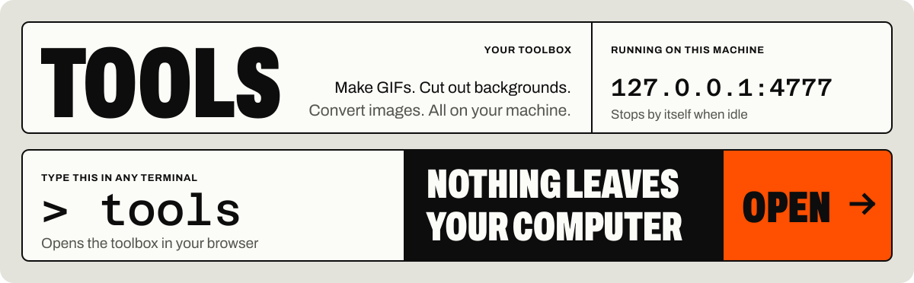
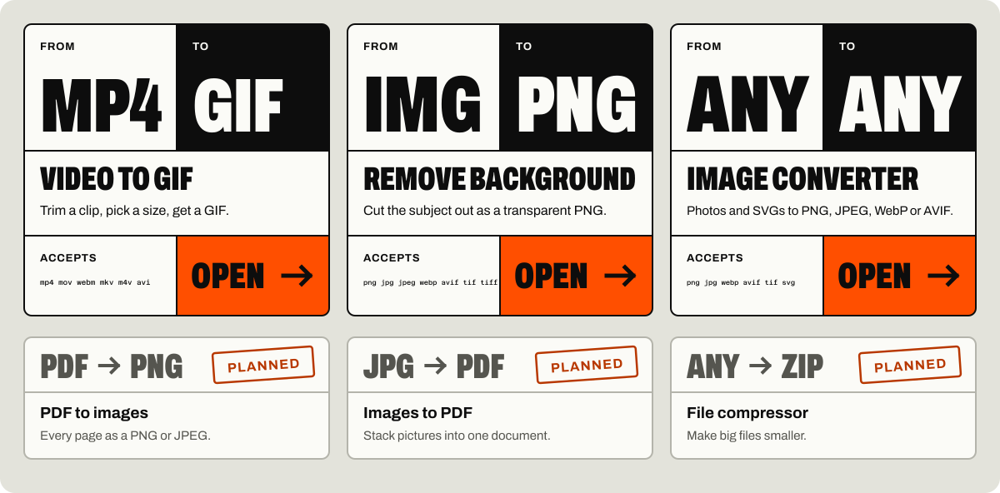
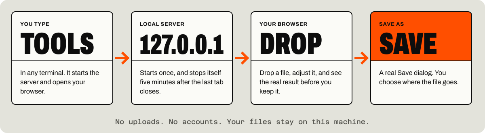

<p align="center">
  
</p>

<p align="center">
  <b>A local toolbox for everyday file jobs.</b><br>
  Type <code>tools</code> in any terminal. Drop a file, adjust it, see the real result, save it where you like.
</p>

<p align="center">
  <sub>Windows &nbsp;·&nbsp; Bun &nbsp;·&nbsp; MIT licence</sub>
</p>

<br>

## The tools

<p align="center">
  
</p>

| Tool | What it does |
|---|---|
| **Video to GIF** | Trim a clip, set the frame rate, width and quality, and get a size estimate. An optional "keep under N MB" limit shrinks the GIF until it fits. Reads MP4, MOV, WebM, MKV, M4V and AVI. |
| **Remove background** | Drop an image, get the subject as a transparent PNG at full resolution. Runs an AI model on your own machine, on the CPU: roughly 5 to 10 seconds per image on a fast computer, longer on a slower one. |
| **Image converter** | Reads PNG, JPEG, WebP, AVIF, TIFF and SVG. Writes PNG, JPEG, WebP or AVIF, with a quality slider and a width. It re-converts as you change settings, so the size shown is the real size of the file you would save. Photos are stood upright and stripped of camera and location data. An SVG is drawn fresh at the width you pick (up to 8192 px), so it stays sharp. |

**Planned:** PDF to images, images to PDF, file compression.

<br>

## How it works

<p align="center">
  
</p>

- **Your files stay on this machine.** The server listens on `127.0.0.1` only. The one thing fetched from the internet is the background-removal model, downloaded once (109 MB) the first time you use that tool.
- **One command.** `tools` returns your prompt straight away, and running it again reuses the server that is already up.
- **It cleans up after itself.** The server exits five minutes after the last tab closes, and uploads and results in the temp folder go with it.

<br>

## Install

You need Windows and [Bun](https://bun.sh) 1.3 or newer.

```bash
git clone https://github.com/Skullmc1/tools.git
cd tools
bun install
bun link
```

`bun link` puts a `tools` command in `~/.bun/bin`, which Bun adds to your PATH. Bun may report two blocked install scripts; nothing here needs them.

## Use

```bash
tools           # open the app (starts it in the background if needed)
tools --stop    # stop the background server
tools --help
```

The first run checks for what the tools need, which is currently [FFmpeg](https://ffmpeg.org) for Video to GIF. If it is missing, `tools` offers to install it with `winget`, and asks first.

After `git pull`, run `tools --stop` once so the next `tools` starts the new code.

<br>

## Where things live

| Path | What |
|---|---|
| `~/.tools/server.json` | The running server's pid and port |
| `~/.tools/config.json` | The last folder you saved to |
| `~/.tools/server.log` | Server log |
| `~/.tools/models/` | The background-removal model. Delete the folder to remove it |
| `%TEMP%\tools-app\` | Uploads and results, deleted when the server stops |

<br>

## Develop

```bash
bun run dev          # server with hot reload at http://127.0.0.1:4777
bun test             # unit tests, plus real ffmpeg and image conversions
bun run typecheck
```

`bun test` never downloads the model. To also run the test against the real model, set `TOOLS_TEST_MODEL=1` (the first run downloads 109 MB; point `TOOLS_TEST_MODEL_SEED` at an existing transformers.js cache folder to skip that). Set `TOOLS_MODELS_DIR` to keep the model somewhere other than `~/.tools/models`.

<details>
<summary><b>Project layout</b></summary>

```
src/
  cli/        the `tools` command: dependency setup, start or reuse the server, open the browser
  platform/   everything OS-specific (browser, Save dialog, installer). Only windows.ts exists
  server/     Bun.serve, uploads, jobs with progress, saving, idle shutdown, shared image helpers
  tools/      one folder per tool, plus the registries
  web/        React app shell, home page, shared components, styles
docs/assets/  the SVG art in this README
scripts/      readme-art.py draws that art
tests/
```

</details>

<details>
<summary><b>Adding a tool</b></summary>

1. Add its entry to `src/tools/manifests.ts` (or flip a planned one to `status: "live"`). List any programs it needs in `requires`, and teach `src/platform/windows.ts` which package provides them.
2. Create `src/tools/<id>/server.ts` exporting a `ToolServer`: routes under `/api/<id>/`. Use `ctx.workspace` for uploads and temp files and `ctx.jobs.start(...)` for long work. Progress, cancelling, previewing and saving the result then work without more code.
3. Create `src/tools/<id>/ui.tsx` exporting the screen component. Shared pieces include `DropZone`, `PrintProgress`, `SaveBox` and `Segmented`.
4. Register them in `src/tools/registry.server.ts` and `src/tools/registry.client.tsx`.

The visual system is described in [DESIGN.md](DESIGN.md). New screens should use its components as they are.

</details>

<details>
<summary><b>Redrawing the README art</b></summary>

The images in `docs/assets/` are generated, in the same colours and fonts as the app. Text is converted to outlines, because GitHub does not load custom fonts inside an image. After `bun install` (the fonts come from `node_modules`):

```bash
uv run --with fonttools --with brotli --with uharfbuzz scripts/readme-art.py
```

</details>

<br>

## Security

The server listens on `127.0.0.1` only and rejects API requests whose `Host` or `Origin` is not its own, so other websites cannot drive it. The save location always comes from the native Save dialog, never from a request. An SVG can only read files from its own folder, which is a private temp folder.

## Licences

This project is [MIT licensed](LICENSE). It depends only on permissively licensed software (MIT, BSD, Apache-2.0, ISC), and nothing copyleft is bundled in this repo.

- **Fonts**: Archivo and Azeret Mono, under the SIL Open Font License, served from `node_modules` and never from a CDN.
- **sharp** ships a prebuilt copy of libvips (LGPL-3.0, dynamically linked, installed separately by `bun install`). This matters only if you redistribute a packaged build of the app.
- **Background removal** uses [BiRefNet](https://github.com/ZhengPeng7/BiRefNet) (MIT), in the [onnx-community/BiRefNet_lite-ONNX](https://huggingface.co/onnx-community/BiRefNet_lite-ONNX) conversion, pinned to one exact revision. It runs through [transformers.js](https://github.com/huggingface/transformers.js) (Apache-2.0) and [sharp](https://sharp.pixelplumbing.com) (Apache-2.0). The model is downloaded from Hugging Face on first use rather than stored in this repo.
- **Video to GIF** runs your own installed FFmpeg; it is not bundled.
